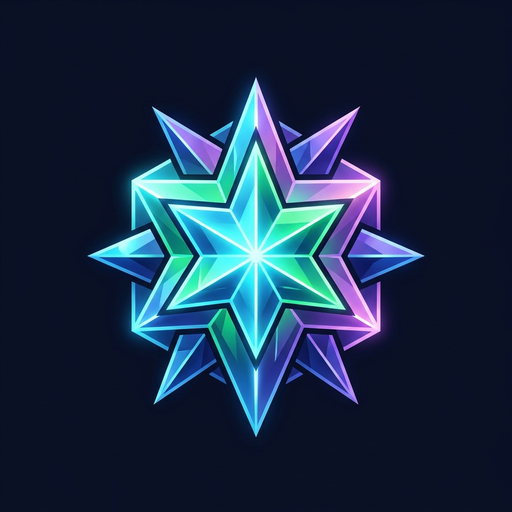

<div align="center">



# NovaCraft

Launcher Minecraft Java Edition untuk Android.

[](LICENSE)
[-3DDC84?logo=android&logoColor=white)](https://developer.android.com)

[**Unduh**](#unduh) · [Cara mulai](#cara-mulai) · [Fitur](#fitur) · [Bantuan](#bantuan) · [Kredit](#lisensi-dan-kredit)

</div>

> NovaCraft adalah proyek independen dan tidak berafiliasi dengan Mojang Studios, Microsoft, maupun proyek pihak ketiga yang disebut di bawah.

## Tentang

NovaCraft adalah launcher untuk memainkan Minecraft Java Edition di Android. Alurnya sederhana: buat instance, pasang mod bila perlu, lalu main.

- **Instance terpisah**: tiap instance punya versi, mod, dan pengaturan sendiri.
- **Setelan awal otomatis**: RAM game, skala resolusi, dan jarak pandang menyesuaikan RAM perangkat, dan semuanya bisa diubah.
- **Mod dan konten**: Vanilla, Fabric, Forge, dan NeoForge, dengan mod dan peta dunia dari Modrinth dan CurseForge.

## Unduh

**Kebutuhan:** Android 8.0 (API 26) atau lebih baru, CPU **64-bit (`arm64-v8a`)**, RAM 3 GB ke atas (4 GB lebih nyaman), dan ruang kosong beberapa GB. Dukungan 32-bit (`armeabi-v7a`) telah dihapus.

| Berkas | Untuk siapa |
|---|---|
| `NovaCraft-<versi>-64bit-arm64-v8a.apk` | **Satu-satunya berkas rilis (64-bit arm64-v8a).** Dioptimalkan untuk stabilitas dan performa perangkat Android 64-bit. |

## Cara mulai

1. **Buka NovaCraft.** Di Android 11 ke atas, launcher mematuhi aturan Scoped Storage Android 11+ menggunakan folder privat aplikasi (`novacraft`) dan pemilih SAF untuk mengimpor berkas/dunia.
2. **Tambahkan akun** di menu **Akun**: Microsoft atau Ely.by untuk bermain online, atau mode offline dengan penyimpanan sesi lokal.
3. **Buat instance** lewat **Buat Instance**: pilih versi Minecraft, lalu Vanilla, Fabric, Forge, NeoForge, atau mesin Rust (Horizon).
4. Di **Home**, tekan **UNDUH** dan tunggu selesai (butuh internet), lalu tekan **PLAY**.
5. Pasang mod, resource pack, shader, dan dunia Java (`.zip` / folder `saves/`) lewat menu **Mod & Dunia**.

## Fitur

**Game**
- **Banyak instance terpisah**, masing-masing dengan versi, mod, dan pengaturan sendiri.
- **Vanilla, Fabric, Forge (1.13+), dan NeoForge (1.20.2+)**. Pencarian mod, modpack, dan dunia otomatis disesuaikan dengan loader & versi instance.
- **Java bawaan**: Java 8, 17, 21, dan 25, dipilih otomatis sesuai versi Minecraft instance.
- **Pilihan renderer**: Auto (disarankan), Krypton, MobileGlues, GL4ES, Kopper Zink, dan Freedreno (Snapdragon Turnip).

**Mod dan konten**
- **Modrinth dan CurseForge** langsung dari aplikasi: mod, modpack, resource pack, shader, datapack, dan toko dunia dengan rekomendasi otomatis.
- **Impor terpadu**: impor arsip `.zip` maupun folder dunia Minecraft Java (validasi `level.dat` NBT & struktur resmi Mojang).

**Kontrol & Lainnya**
- **Editor kontrol sentuh**, hotbar sentuh, dukungan controller (gamepad), dan mouse/keyboard fisik.
- **Akun** Microsoft, Ely.by, dan offline.
- **Rekam layar bawaan** dan **Laporan crash** dengan opsi berbagi log.
- **Antarmuka multibahasa**: Indonesia, English, Español, Tiếng Việt, Português (Brasil), dan ภาษาไทย.

## Bantuan

- **Game tertutup sendiri atau crash**: beri RAM game tidak lebih dari sekitar setengah RAM HP, tutup aplikasi lain, atau turunkan rasio resolusi di **Pengaturan**. Laporan crash bisa dilihat dari dalam aplikasi.
- **FPS rendah**: kecilkan jarak pandang, turunkan rasio resolusi, atau coba renderer lain di **Pengaturan**.
- **Mod tidak jalan**: pastikan loader dan versi Minecraft instance sama dengan yang dibutuhkan mod.

## Privasi dan keamanan

- Kata sandi Microsoft tidak pernah disimpan; login memakai jendela OAuth resmi Microsoft.
- Aset dan pustaka Minecraft diunduh langsung dari server resmi Mojang dan dicocokkan dengan sidik jari (SHA-1) resminya.
- Semua sambungan internet memakai HTTPS.

## Untuk pengembang

Butuh JDK 17 dan Android SDK (compile SDK 36, min SDK 26, target ABI `arm64-v8a`).

```bash
gradle assembleRelease
```

## Lisensi dan kredit

NovaCraft dirilis di bawah **GNU General Public License v3.0** (lihat [LICENSE](LICENSE)).

NovaCraft adalah turunan dari NUX Launcher / AmberLauncher, yang berbasis Zalith Launcher 2 dan PojavLauncher. Sesuai ketentuan tambahan Zalith Launcher 2, nama "ZalithLauncher" atau "ZL" tidak dipakai, dan keterangan *Unofficial Modified Version* serta pemberitahuan hak cipta tetap ditampilkan di aplikasi.

*Minecraft* adalah merek dagang Mojang AB / Microsoft Corporation. NovaCraft tidak menyertakan atau membagikan salinan game; untuk bermain online, kamu perlu akun Minecraft Java Edition yang sah.

